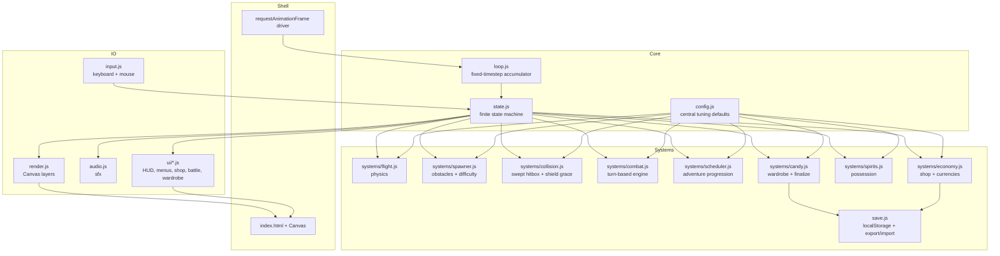
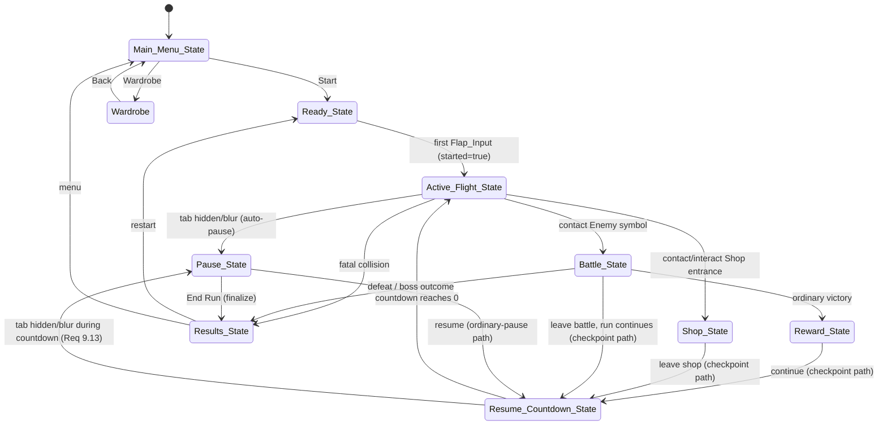

# Design Document

## Overview

Flappy Kiro is a desktop-first, Halloween-themed flying RPG built to ship in a single evening. Ghosty flies through scrolling pipes, optionally engages turn-based battles, shops with in-run currency, possesses defeated spirits, and fights a final boss. Across runs, players earn Candy and buy cosmetic hats.

This design is deliberately small and pragmatic. It targets a vanilla web stack with no framework, no build step, no backend, and no network:

- A single `index.html` loads ES modules directly.
- Rendering uses one HTML5 Canvas.
- All logic is plain modular JavaScript.
- The game runs by opening the file in a modern desktop browser, or behind a trivial static server if the browser restricts `file://` module loading.

### Small-architecture rationale for the deadline

The hard parts of this game are not the frameworks — they are correctness and fairness: frame-rate-independent physics, forgiving-but-fair collisions, deterministic combat math that guarantees the base Ghosty can beat the boss, an economy that never goes negative, and a save system that round-trips between browsers. The architecture spends its complexity budget there and nowhere else.

Three decisions keep the codebase lean while protecting those guarantees:

1. **A fixed-timestep simulation decoupled from rendering** makes physics and collisions deterministic and frame-rate independent (Requirement 1.1, 1.9, 1.10) without any engine.
2. **A single explicit finite state machine** centralizes the three-clock advancement rule (Requirement 9.2) — flight simulation time advances only in `Active_Flight_State`, the Resume countdown advances only in `Resume_Countdown_State`, and combat cooldowns advance by resolved turns only in `Battle_State` — and the no-input-leak rule (Requirement 9.6) in one place instead of scattering flags.
3. **One central config module** sourced from the Configurable Initial Defaults table means balancing is a single-file edit, and nothing is hardcoded in scattered constants.

The systems are organized as small pure functions operating on plain-object state wherever possible, so the risky logic (simulation, combat, economy, save) is unit-testable without a browser. Rendering, input, and audio are the only parts that touch the DOM, and they are kept thin.

Missing art (ordinary enemies ×2, final boss, hats ×4, spirits ×2) does not exist yet and MUST NOT block proving the core loop. The renderer draws labeled placeholder shapes for any missing sprite and swaps in real art later with no logic changes.

## Architecture

### High-level component diagram



The driver (`requestAnimationFrame`) feeds wall-clock time to the loop. The loop runs fixed-timestep simulation ticks and then one interpolated render. The FSM decides which clock a tick advances (Requirement 9.2): only in `Active_Flight_State` do flight, spawner, collision, scheduler, Active_Flight_Time accrual, Hover, and flight cooldowns advance; only in `Resume_Countdown_State` does the Resume countdown advance; only in `Battle_State` do combat cooldowns and turns advance, and they advance by resolved turns rather than by seconds. Every system reads tuning from `config.js`. Input is translated into intents routed through the FSM so inputs cannot leak across states.

### Separation of concerns

- **Pure logic** (`systems/*`, `save.js`, parts of `state.js`): no DOM access; deterministic given state + config + inputs. This is where unit and property tests live.
- **IO** (`render.js`, `input.js`, `audio.js`, `ui/*`): the only DOM-touching code. Thin and example/manual-tested.
- **Config** (`config.js`): the single source of tuning truth.

## Fixed-Timestep Simulation Loop

Physics and collisions MUST be frame-rate independent (Requirement 1.1) and MUST never be changed by visual interpolation (Requirement 1.10). The loop uses the standard accumulator pattern with a fixed simulation step and a maximum per-frame clamp.

- `FIXED_DT` = 1/120 s simulation step (small enough that at max scroll speed 220 px/s the world advances ≈1.83 px per tick, well under the pipe width of 70 px; this holds regardless of the 960-wide Logical_Playfield, and combined with the swept collision check it prevents tunneling, Requirement 3.10).
- `MAX_FRAME_TIME` = 0.100 s. If the time since the last frame exceeds 100 ms (background tab, stall), the frame time is clamped so the simulation never does a large catch-up jump (Requirement 1.9).

### Loop algorithm (pseudocode)

```
let accumulator = 0
let lastTime = now()

function frame(currentTime):
    let frameTime = (currentTime - lastTime) / 1000
    lastTime = currentTime
    if frameTime > MAX_FRAME_TIME: frameTime = MAX_FRAME_TIME   // Req 1.9 clamp

    accumulator += frameTime
    while accumulator >= FIXED_DT:
        fsm.tick(FIXED_DT, consumeInputIntents())   // one deterministic sim step
        accumulator -= FIXED_DT

    let alpha = accumulator / FIXED_DT               // render interpolation factor
    render(fsm.state, alpha)                         // visual only, Req 1.10
    requestAnimationFrame(frame)
```

Key rules:
- The simulation only ever advances in whole `FIXED_DT` steps, so identical input sequences produce identical collision outcomes regardless of display refresh rate (Requirement 1.1).
- `alpha` interpolates sprite positions between the previous and current simulation state **for drawing only**. Collision checks always read the committed simulation state, never the interpolated value (Requirement 1.10).
- `fsm.tick` dispatches to exactly one clock per state (Requirement 9.2), never a universal freeze:
  - In `Active_Flight_State` it advances **flight simulation time** — flight physics, obstacle movement and spawning, flight collision checks, Active_Flight_Time, Hover duration and cooldown, and all Flight_Power and flight cooldowns.
  - In `Resume_Countdown_State` it advances only the **countdown/UI clock** while the frozen flight world stays untouched.
  - In `Battle_State` it advances **resolved combat turns**; combat cooldowns move by turns, never by seconds.
  - In every other state (Ready, Pause, Reward, Shop, Results, Main_Menu, Wardrobe) none of the three clocks advance.
  - While the browser tab is hidden, none of the three clocks advance (Requirement 9.3).

### FSM tick dispatch (pseudocode)

```
function tick(dt, intents):
    if documentHidden:
        return                                   // Req 9.3: advance no clock
    switch state:
        case Active_Flight_State:
            stepFlight(runState, intents, dt, config)     // physics + Hover + flap
            stepSpawner(pipes, scrollSpeed, dt, rng, ...)
            sweptHitboxVsPipes(prevBox, currBox, pipes, ...)
            activeFlightTime += dt                        // flight-sim clock (a)
            advanceFlightCooldowns(runState, dt)          // Hover + Flight_Power
            stepScheduler(progress, activeFlightTime, config)
        case Resume_Countdown_State:
            countdownRemaining -= dt                       // countdown clock (b)
            if countdownRemaining <= 0: transition(resumeTarget)
        case Battle_State:
            // combat clock (c): advances only when a turn resolves,
            // driven by player/enemy action intents, never by dt
            resolveCombatTurns(battle, intents, runState, config)
        default:
            return                                         // no clock advances
```

## Components and Interfaces

All functions below are pure unless noted (they take state + config + inputs and return new/mutated state with no DOM access). Signatures are typedef-style, not application code.

### config.js
- `CONFIG`: a frozen object holding every value from the Configurable Initial Defaults table (960×640 playfield, gravity, flap, Ghosty logical body size and initial center, Hover duration/cooldown, scroll milestones, hitbox inset, combat numbers and boss action sequence, prices, triggers, candy formula constants, resume countdown, save version). Every other module imports from here; no tuning constant is defined elsewhere.

### loop.js
- `startLoop(fsm, render, input)`: installs the `requestAnimationFrame` driver described above.

### state.js (FSM)
- `createFSM(config, save)` → `fsm`
- `fsm.tick(dt, intents)`: advances the current state by dispatching to the correct clock (flight-sim in `Active_Flight_State`, countdown in `Resume_Countdown_State`, resolved turns in `Battle_State`, nothing otherwise and nothing while the tab is hidden; Requirement 9.2, 9.3); returns nothing (mutates internal state).
- `fsm.transition(toState)`: validated state change; applies the clock-freeze/thaw and input-barrier rules, and routes resumption through the ordinary-pause (exact-state) or checkpoint (reposition) path (Requirement 9.10–9.16).
- `fsm.state`: current `GameState` enum + the active `RunState` (or null).

### systems/flight.js
- `stepFlight(runState, intents, dt, config)` → `runState`: integrates gravity, applies Normal_Flap (sets velocity, Req 1.3), and drives the Hover state machine (Req 6.9, 6.12–6.17). Hover is the Storm_Bat Flight_Power: when activated it sets `vy = 0` and suspends gravity for the configured Hover duration (0.6 active-flight s) while pipes keep moving and Active_Flight_Time keeps accruing; collision rules stay active throughout. It clamps terminal downward velocity when gravity is active.
- Hover timing: `hoverRemaining` (active-flight seconds of suspended gravity left) and `hoverCooldown` (active-flight seconds until Hover is ready again, started on activation at the configured 5 s) both advance only in `Active_Flight_State` and both freeze outside it (Req 6.17). A same-tick Normal_Flap beats Hover activation (Req 6.16). A Normal_Flap while Hover is active cancels Hover, applies the flap velocity, and does not refund the cooldown (Req 6.14). Natural expiry resumes gravity from `vy = 0` (Req 6.15). Switching Spirits never refills `hoverCooldown` (Req 6.17).
- `activateHover(runState, config)` → `runState`: the Flight_Power activation path; activates only if `hoverCooldown <= 0`, otherwise ignores the request leaving velocity and cooldown unchanged (Req 1.7, 1.8).

### systems/spawner.js
- `stepSpawner(pipes, scrollSpeed, dt, rng, lastGapCenter, config)` → `{ pipes, lastGapCenter }`: moves pipes left, spawns new pairs at fixed horizontal spacing, removes off-screen pairs (Req 2.9).
- `currentScrollSpeed(activeFlightTime, config)` → `number`: base + increments for milestones reached, capped (Req 2.2, 2.3).
- `placeGap(prevCenter, rng, config)` → `gapCenter`: honors min clearance (Req 2.5) and max gap-center delta (Req 2.6).

### systems/collision.js
- `sweptHitboxVsPipes(prevBox, currBox, pipes, shield, graceId, config)` → `CollisionResult`: swept check across the step; returns `{ outcome: 'none'|'shield'|'fatal', pipeId, clearedGraceId }`.
- `hitboxFor(ghosty, config)` → `Hitbox`: sprite bounds inset by the configured amount; never enlarged by hats/decorations/scale (Req 3.8, 3.9).
- `groundCeilingFatal(box, config)` → `bool` (always fatal, even shielded; Req 3.5, 3.6).

### systems/combat.js
- `startBattle(runState, enemy, config)` → `BattleState`: builds a fresh battle against `enemy` but reads player ability cooldowns from the owning `runState`/per-ability state so that creating a BattleState never refills or resets a player cooldown (Req 5.20). Initializes `bossActionIndex = 0` for a boss.
- `resolvePlayerAction(battle, action, runState, config)` → `BattleState` (player acts first, Req 5.13). Player ability cooldowns count subsequent **resolved player turns**: no decrement on the turn that starts the cooldown nor on an invalid/cancelled action (Req 5.5, 5.16); the 2-turn lightning move blocks the next two resolved player turns (Req 5.17). Potion use is handled here as a player action (see Potions below).
- `resolveEnemyTurn(battle, config)` → `BattleState` (skipped if the battle already ended on the player turn, Req 5.14). For the boss it reads the next action from the configured enemy-action sequence via `bossActionIndex` (Normal → Telegraph → Special → Normal → Normal → Normal → Telegraph → Special); a Telegraph turn deals no damage (Req 5.18, 5.19); boss ability cooldowns count subsequent **resolved enemy turns**, so the 3-turn special cooldown needs three subsequent enemy turns before telegraphing again. Advances `bossActionIndex` only when the enemy actually takes a turn (a defeated enemy takes none, Req 5.19).
- `usePotion(runState, battle | null, config)` → `{ runState, battle, ok, reason }`: consumes exactly one owned potion, heals up to the configured potion effect capped at `maxBattleHp`; a no-op (consumes nothing) at full HP or with zero potions (Req 5.24, 5.25, 7.13, 7.14). In `Battle_State` it consumes one player turn so the enemy responds; in `Shop_State` it consumes no combat turn, keeps flight frozen, and accrues no Candy time (`battle` is null). One consume per confirmed action (Req 5.16, 7.16).
- `applyPercentReduction(rawDamage, percent)` → `int` = `max(0, floor(rawDamage * (1 - percent)))` (Req 5.15)

### systems/scheduler.js
- `stepScheduler(progress, runState, activeFlightTime, config)` → `{ progress, spawned }`: when Active_Flight_Time crosses a configured threshold it **spawns** an avoidable Shop entrance or optional Enemy symbol into the flight world (it does NOT freeze flight on spawn, Req 4.15, 7.4); the Final_Boss is presented at a safe checkpoint (Req 4.3). Each entrance/symbol advances through the lifecycle `offered → entered → completed → skipped`: contact or explicit interaction marks it `entered` and transitions to `Shop_State`/`Battle_State`; passing it without interacting marks it `skipped` and it never retriggers (Req 4.17, 4.18). Keeps at least one safe route through the current Gap unobstructed (Req 4.14).
- `markSkipped(progress, entranceId)` / `markEntered(progress, entranceId)`: lifecycle transitions kept in `ScheduleProgress`.

### systems/economy.js
- `purchase(runState, itemId, config)` → `{ runState, ok, reason }`: validates affordability, duplicates, attack-upgrade limit; never produces a negative balance (Req 7.6–7.8). Buying a potion deducts the potion price and increments `items.potion` by exactly one; duplicate/repeated input counts as a single purchase per confirmed action (Req 7.12). Buying a Shield charge respects the one-charge cap.
- `shopInventory(config)` → `ShopItem[]`

### systems/checkpoint.js (resume support)
- `selectCheckpoint(runState, config)` → `{ x, y, vy: 0 }`: computes the safe flight checkpoint used when returning to `Active_Flight_State` from `Battle_State`/`Reward_State`/`Shop_State` (Req 9.14–9.16). If Ghosty's Hitbox is within a Pipe_Pair's horizontal span, it centers Ghosty vertically in that pair's Gap at the current x; otherwise it centers Ghosty vertically in the nearest upcoming pair's Gap at an x with full clearance before that pair. In both cases it verifies the resulting Hitbox clears every nearby obstacle, the Ground, and the Ceiling before resuming. The resume flow then awards no Pipe_Score for unpassed pairs and synchronizes `prevY`/previous position with the new position so no interpolation artifact or false pass occurs (Req 9.16). Ordinary pauses do NOT call this — they resume from the exact frozen state (Req 9.11).

### systems/spirits.js
- `possess(runState, spiritId, config)` → `runState`: replaces equipped spirit, grants one-time Pumpkin_Guardian shield gift respecting the per-run flag and cap, never refills on switch (Req 6.10, 6.11).

### systems/candy.js
- `candyForRun(activeFlightTime, bossDefeated, config)` → `int` = `floor(activeFlightTime/15) + (bossDefeated ? bonus : 0)` (Req 8.1, 8.2)
- `finalizeRun(runState, save, config)` → `{ save, finalized }`: idempotent; awards Candy and updates high score exactly once (Req 8.6, 11.14).

### save.js
- `loadSave(config)` → `SaveData`: reads localStorage, validates, falls back to defaults on missing/corrupt (Req 11.2, 11.3).
- `writeSave(save)` → `{ ok, error? }`: persists promptly; reports failure without crashing (Req 11.4, 11.5).
- `exportSave(save)` → `Blob` (JSON with game id + version + progress + prefs, excludes unfinished run, Req 11.7).
- `parseImport(text, config)` → `{ ok, save?, error? }`: full validation before any change (Req 11.8, 11.9).

### render.js / input.js / audio.js / ui/*
- `render(state, alpha)`: draws Canvas layers; interpolation-only (Req 1.10).
- `pollInput()` → `Intent[]`: translates raw events into state-scoped intents with held-key debounce.
- `playSfx(name)`: respects audio-activation; no-op on missing/blocked audio (Req 1.11, 12.4, 12.5).

## Data Models

All shapes are plain JS objects (typedef-style). Glossary terms are used verbatim.

### RunState

Created at the Ready → first-flight transition with the full initialization from Requirement 7.10/7.11.

```
RunState = {
  started: boolean,          // true once flight begins (Req 9.9 distinguishes unstarted)
  pipeScore: int,            // 0
  soulCoins: int,            // 0
  battleHp: int,             // config.startingBattleHp (22)
  maxBattleHp: int,          // config.startingBattleHp, run cap for potions
  activeFlightTime: number,  // 0, seconds; accrues ONLY in Active_Flight_State
  equippedSpirit: 'none' | 'storm_bat' | 'pumpkin_guardian',  // 'none'
  shieldCharges: int,        // 0, cap config.shieldCap (1)
  items: { potion: int },    // { potion: 0 }; per-Run consumable inventory (Req 7.10)
  attackUpgradePurchased: boolean,  // false
  attackDamage: int,         // config.playerBaseAttack (5)
  flightPowerCooldown: number,      // 0 = ready (generic Flight_Power readiness)
  hoverRemaining: number,    // 0; active-flight s of suspended gravity left (Req 6.12, 6.15)
  hoverCooldown: number,     // 0 = ready; active-flight s until Hover ready again (Req 6.12, 6.17)
  lightningCooldown: int,    // 0 = ready; per-ability player cooldown owned on the run so battle creation/spirit switch never refills it (Req 5.20)
  pumpkinShieldGiftUsed: boolean,   // false, per-run latch (Req 6.10)
  enemiesDefeated: int,      // 0
  bossDefeated: boolean,     // false
  finalized: boolean,        // false, one-shot guard (Req 8.6)
  progress: ScheduleProgress,// pointers at starting positions
  ghosty: Ghosty,
  pipes: PipePair[],
  lastGapCenter: number,
  rngSeed: int
}

ScheduleProgress = {
  // Each optional opportunity tracks a lifecycle so it spawns once, can be
  // avoided, and never retriggers (Req 4.17, 4.18).
  // lifecycle: 'pending' | 'offered' | 'entered' | 'completed' | 'skipped'
  encounterA: LifecycleEntry,  // first Enemy (type A) symbol
  shop1: LifecycleEntry,       // first Shop entrance
  encounterB: LifecycleEntry,  // second Enemy (type B) symbol
  shop2: LifecycleEntry,       // second Shop entrance
  bossPresented: boolean       // boss is required, not optional — no skip lifecycle
}

LifecycleEntry = {
  id: int,
  state: 'pending' | 'offered' | 'entered' | 'completed' | 'skipped',
  spawned: boolean             // true once the avoidable entrance/symbol is in the flight world
}
```

### Ghosty, PipePair, Hitbox

```
// x/y are CENTER coordinates (logical px). Both the sprite draw rect and the
// collision rect derive from center ± half of the configured logical body size
// (≈32×39) — the PNG's natural pixel dimensions are NEVER used as gameplay
// dimensions (aspect ratio is preserved only when drawing). Initial center
// (160, 320); initial vy 0 (Ghosty is stationary in Ready_State until the first
// flap). prevY (previous center y) is for render interpolation only.
Ghosty = { x: number, y: number, vy: number, prevY: number, prevX: number }

PipePair = {
  id: int,
  x: number,            // left edge, logical px
  gapCenter: number,    // logical px
  gapHeight: number,    // config.gapHeight (180)
  scored: boolean,      // Req 10.2 one point per pair
  shieldGrace: boolean  // true while this pair cannot end the run (Req 3.3)
}

// Hitbox derives from Ghosty's center ± half the logical body size, then inset
// by config.hitboxInset (4) per side → ≈24×31 logical px. Never enlarged by
// hats, spirit decorations, sprite margins, particles, or display scale.
Hitbox = { x: number, y: number, w: number, h: number }  // top-left + size, logical px
```

### Enemy, Spirit

```
Enemy = {
  type: 'A' | 'B' | 'boss',   // A = Storm_Bat enemy, B = Pumpkin_Guardian enemy
  battleHp: int,              // 12 ordinary, 30 boss
  maxBattleHp: int,
  attackDamage: int,          // 3 ordinary; boss normal 4
  spiritReward: 'storm_bat' | 'pumpkin_guardian' | null,  // null for boss
  isBoss: boolean
}

Spirit = {
  id: 'storm_bat' | 'pumpkin_guardian',
  flightBenefit: 'hover' | 'none',       // Storm_Bat grants Hover (Req 6.7)
  combatBenefit: 'lightning' | 'fortify',// one combat move each (Req 6.6)
  oneTimeShieldGift: boolean             // true for Pumpkin_Guardian only
}
```

### BattleState

```
BattleState = {
  enemy: Enemy,
  round: int,
  phase: 'player' | 'enemy' | 'ended',
  resolvedPlayerTurns: int,       // count of resolved player turns (drives player cooldowns)
  resolvedEnemyTurns: int,        // count of resolved enemy turns (drives boss cooldowns)
  defendActive: boolean,          // reduces next incoming hit, cleared after it resolves (Req 5.7)
  defendPercent: number,          // 0.50 normal, 0.75 fortified
  // Player ability cooldowns are OWNED by the run/per-ability state, not reset on
  // battle creation or spirit switch (Req 5.20). The authoritative lightning
  // cooldown lives on RunState.lightningCooldown; BattleState reads/writes it.
  bossActionIndex: int,           // index into config.bossActionSequence; advances only when the enemy takes a turn
  bossSpecialCooldown: int,       // remaining subsequent resolved enemy turns before the special may telegraph again
  bossSpecialTelegraphed: boolean,// special lands on the next enemy turn
  outcome: 'ongoing' | 'victory' | 'defeat',
  log: string[]
}
```

Cooldown counting (Req 5.16): a player ability cooldown decrements by one per **subsequent resolved player turn** and a boss ability cooldown by one per **subsequent resolved enemy turn**; neither decrements on the turn that starts the cooldown nor on an invalid/cancelled action — the decrement happens after the relevant subsequent turn resolves. The 2-turn lightning move blocks the next two resolved player turns; the 3-turn boss special cooldown needs three subsequent resolved enemy turns. The boss enemy-action sequence `Normal → Telegraph → Special → Normal → Normal → Normal → Telegraph → Special` is walked by `bossActionIndex` (a Telegraph deals no damage; a defeated enemy takes no turn and does not advance the index).

### ShopItem, SaveData

```
ShopItem = {
  id: 'potion' | 'shield' | 'attack_upgrade',
  effectText: string,
  price: int,            // soul coins
  maxQuantity: int | null, // attack_upgrade limited to 1 per run; potion has no cap (stacks in items.potion)
  purchasedThisRun: int
}
// Buying a potion increments RunState.items.potion by one (Req 7.12). Using a
// potion (battle or shop) consumes exactly one from items.potion (Req 7.16).

SaveData = {
  gameId: 'flappy-kiro',
  version: int,                 // config.saveVersion (1)
  highScore: int,
  candy: int,
  ownedHats: string[],          // hat ids; always includes implicit 'none'
  equippedHat: string,          // must be owned or 'none'
  prefs: { muted: boolean, reducedMotion: boolean }
}
```

### Save schema (persisted JSON)

```json
{
  "gameId": "flappy-kiro",
  "version": 1,
  "highScore": 0,
  "candy": 0,
  "ownedHats": [],
  "equippedHat": "none",
  "prefs": { "muted": false, "reducedMotion": false }
}
```

`SaveData` deliberately contains no run state, so an unfinished run is never persisted or restored (Req 11.12).

## State Machine, Freezing, and Resumption

The FSM owns the three-clock model (see Fixed-Timestep Simulation Loop) and the two resumption paths. Resumption always passes through `Resume_Countdown_State` so the Player sees the configured countdown before flight resumes (Req 9.5).

### State transitions (overview)



Only `Active_Flight_State` advances flight simulation; `Resume_Countdown_State` advances only the countdown while flight stays frozen; `Battle_State` advances combat by resolved turns; all other states advance no clock; a hidden tab advances none (Req 9.2, 9.3).

### Ordinary-pause resumption (exact-state)

An ordinary pause (manual or auto-pause from tab visibility/focus loss, Req 9.7) preserves the EXACT frozen flight state: Ghosty's exact position and velocity, the exact obstacle set, the Hover remainder, all cooldowns, the Shield_Grace state, Pipe_Score, the spawn scheduler state, and the RNG state (Req 9.10). On resume, after the countdown, flight continues from that exact state with NO recenter and NO velocity reset (Req 9.11). The input that dismisses the pause is dropped at the transition boundary so it cannot leak as a Flap_Input or any other flight action (Req 9.12). If the tab loses visibility or focus during the countdown, resumption is suspended and a deliberate resumption input is required before counting down again (Req 9.13).

### Battle/Reward/Shop-exit resumption (checkpoint)

Returning to `Active_Flight_State` after `Battle_State`, `Reward_State`, or `Shop_State` uses `selectCheckpoint` (see systems/checkpoint.js). It prepares a safe flight checkpoint, sets `vy = 0`, and preserves Run progress, the consumable inventory, Shield charges, the Hover remainder, and all cooldowns; it grants no free invulnerability and no resource refill (Req 9.14).

```
function resumeFromCheckpoint(runState, config):
    cp = selectCheckpoint(runState, config)     // {x, y, vy:0}
    runState.ghosty.x = cp.x
    runState.ghosty.y = cp.y
    runState.ghosty.vy = 0
    runState.ghosty.prevX = cp.x                 // Req 9.16: sync render positions
    runState.ghosty.prevY = cp.y                 //   so no interpolation artifact
    // Req 9.16: award NO Pipe_Score for pairs Ghosty has not actually passed;
    // repositioning never marks an unpassed pair as scored.
    transition(Resume_Countdown_State)           // countdown, then Active_Flight_State

function selectCheckpoint(runState, config):
    box = hitboxFor(runState.ghosty, config)
    pair = pipePairContaining(box.x, runState.pipes)   // hitbox within a pair's horizontal span?
    if pair != null:
        return { x: runState.ghosty.x, y: pair.gapCenter, vy: 0 }  // center in that Gap at current x
    next = nearestUpcomingPair(box.x, runState.pipes)
    x = next.x - config.checkpointClearance            // full clearance before that pair
    chosen = { x: x, y: next.gapCenter, vy: 0 }
    assert hitboxClears(chosen, nearbyObstacles, Ground, Ceiling, config)  // verify before resuming
    return chosen
```

The frozen flight world is retained as a separate snapshot while in `Battle_State` so the flight world is unchanged when the Battle ends (Req 5.22); the ordinary-pause path restores that snapshot exactly, whereas the checkpoint path repositions Ghosty inside it.

## Correctness Properties

*A property is a characteristic or behavior that should hold true across all valid executions of a system — essentially, a formal statement about what the system should do. Properties serve as the bridge between human-readable specifications and machine-verifiable correctness guarantees.*

These properties cover the pure simulation, combat, economy, and save logic — the parts where input variation reveals bugs. Presentation, audio activation, auto-pause wiring, and localStorage persistence are verified by example/integration/manual tests instead (see Testing Strategy).

### Property 1: Frame-rate independence

*For any* input sequence and any two partitions of the same total **accepted simulation time** into frames — with identical initial state, identical RNG seed, and inputs assigned to identical simulation ticks — the fixed-timestep loop SHALL produce equivalent committed simulation state and equivalent collision outcomes. Equivalence is defined over equal accepted simulation time rather than arbitrary equal wall-clock intervals, because the max-step clamp (Property 4) discards differing amounts of real time and is tested separately.

**Validates: Requirements 1.1, 1.10**

### Property 2: Normal_Flap sets velocity

*For any* current vertical velocity, performing a Flap_Input SHALL set Ghosty's vertical velocity to exactly the configured Normal_Flap velocity rather than adding to it.

**Validates: Requirements 1.3**

### Property 3: Held-key debounce

*For any* sequence of key-down, key-held, and key-up events, the number of registered Normal_Flaps SHALL equal the number of discrete key presses (a release is required between presses).

**Validates: Requirements 1.5**

### Property 4: Max-step clamp

*For any* real elapsed frame time, the simulation SHALL advance by at most 100 milliseconds of simulation time for that frame.

**Validates: Requirements 1.9**

### Property 5: Scroll speed schedule

*For any* Active_Flight_Time value, the current scroll speed SHALL equal the base speed plus the increment for each milestone reached, SHALL be non-decreasing in time, and SHALL never exceed the configured maximum.

**Validates: Requirements 2.2, 2.3**

### Property 6: Every generated pipe pair is valid

*For any* generated Pipe_Pair, the full Gap SHALL remain at least the configured minimum clearance from both Ground and Ceiling, and the change in Gap center from the previous pair SHALL be at most the configured maximum gap-center change.

**Validates: Requirements 2.5, 2.6**

### Property 7: Off-screen pipes are bounded

*For any* run of spawner steps, no Pipe_Pair whose trailing edge has passed the left edge of the Logical_Playfield SHALL remain in the active pipe list.

**Validates: Requirements 2.9**

### Property 8: Fatal unshielded pipe contact

*For any* Ghosty position whose Hitbox overlaps a pipe that is not under Shield_Grace, with zero Shield charges available, the collision outcome SHALL be fatal and end the Run.

**Validates: Requirements 3.1**

### Property 9: Shield consumption and same-pipe grace

*For any* Hitbox overlap with a Pipe_Pair while at least one Shield charge is available, the Game SHALL consume exactly one charge, SHALL mark that pair under Shield_Grace, SHALL treat all further contact with that same pair as non-fatal until the Hitbox fully clears it horizontally, and SHALL then end Shield_Grace for that pair.

**Validates: Requirements 3.2, 3.3**

### Property 10: Other hazards stay fatal during grace

*For any* Shield_Grace applied to one Pipe_Pair, contact with a different Pipe_Pair, the Ground, or the Ceiling SHALL remain fatal under normal collision rules.

**Validates: Requirements 3.4**

### Property 11: Ground and Ceiling are always fatal

*For any* number of available Shield charges, Ghosty's Hitbox reaching or crossing the Ground or the Ceiling SHALL end the Run.

**Validates: Requirements 3.5, 3.6**

### Property 12: Cosmetics and scale never change the Hitbox

*For any* equipped Hat, Spirit decoration, or on-screen display scale, the computed Hitbox and all Run physics and combat fields SHALL be identical, so cosmetics and scaling never affect collisions or gameplay.

**Validates: Requirements 3.8, 3.9, 8.9, 12.9**

### Property 13: No tunneling at any scroll speed

*For any* scroll speed up to the configured maximum, if Ghosty's path during one simulation step passes through a pipe, the swept collision check SHALL report that collision.

**Validates: Requirements 3.10**

### Property 14: Player acts first and lethal actions skip the enemy turn

*For any* Battle, the Player's turn SHALL resolve before the enemy's turn within a round, and if the Player's action reduces the enemy's Battle_HP to zero, the enemy SHALL take no turn and deal no damage that round.

**Validates: Requirements 5.6, 5.13, 5.14**

### Property 15: Percentage-reduction rounding

*For any* raw damage and percentage reduction, the resulting damage SHALL equal max(0, floor(raw × (1 − percent))).

**Validates: Requirements 5.15**

### Property 16: Defend protects exactly one incoming attack

*For any* Battle in which the Player selects Defend, the configured reduction SHALL apply to exactly the next incoming enemy attack and SHALL be cleared after that attack resolves.

**Validates: Requirements 5.7**

### Property 17: Cooldowns advance only by resolved turns, by owner

*For any* ability use, a player ability cooldown SHALL decrease by exactly one per subsequent resolved **player** turn and a boss ability cooldown by exactly one per subsequent resolved **enemy** turn; neither SHALL decrement on the turn that starts the cooldown nor on an invalid or cancelled action, neither SHALL advance from real-world waiting or elapsed seconds, the ability SHALL become available again exactly when the cooldown reaches zero, the 2-turn lightning move SHALL block the next two resolved player turns, and creating a BattleState or switching Spirits SHALL NOT refill or reset a player ability cooldown.

**Validates: Requirements 5.8, 5.16, 5.17, 5.20**

### Property 18: Boss follows the explicit enemy-action sequence

*For any* Final_Boss battle advanced over its enemy turns, the enemy actions SHALL follow the configured sequence Normal → Telegraph → Special → Normal → Normal → Normal → Telegraph → Special, the special SHALL be telegraphed on the enemy turn immediately before it lands, a Telegraph turn SHALL deal no attack damage, the special cooldown SHALL require three subsequent resolved enemy turns after a Special resolves before the next telegraph, and a defeated boss SHALL take no further enemy turn and SHALL NOT advance the sequence.

**Validates: Requirements 5.18, 5.19**

### Property 19: Possession never refills resources

*For any* Run state, replacing the equipped Spirit SHALL leave Battle_HP, consumables, Shield charges, and cooldowns unchanged, except for the single documented first-time Pumpkin_Guardian Shield gift, and existing Shield charges SHALL be retained across the switch.

**Validates: Requirements 3.14, 6.11**

### Property 20: Pumpkin_Guardian gift is once per Run and capped

*For any* sequence of possession, re-equip, and re-acquire actions within a Run, the Pumpkin_Guardian Shield gift SHALL be granted at most once, and the Shield charge count SHALL never exceed the configured cap.

**Validates: Requirements 6.10**

### Property 21: Purchases are safe

*For any* sequence of purchase attempts against any Run state, the Soul_Coins balance SHALL never become negative, an unaffordable purchase SHALL be rejected leaving Soul_Coins and inventory unchanged, repeated or duplicate input SHALL cause at most one purchase per confirmed action, a confirmed affordable potion purchase SHALL deduct the potion price and increment `items.potion` by exactly one, and the attack upgrade SHALL never be purchased more than its configured per-Run limit.

**Validates: Requirements 7.6, 7.7, 7.8, 7.12**

### Property 22: Candy formula

*For any* Active_Flight_Time and boss-defeated flag, the Candy earned SHALL equal floor(Active_Flight_Time ÷ 15) plus the configured boss-victory bonus when the Final_Boss was defeated, and SHALL depend on no other time.

**Validates: Requirements 8.1, 8.2, 8.3**

### Property 23: Finalize awards exactly once

*For any* Run state, finalizing the Run any number of times SHALL add that Run's Candy exactly once and SHALL update the saved high score at most once (only when the final Pipe_Score exceeds the stored high score).

**Validates: Requirements 8.6, 11.14**

### Property 24: One point per fully-passed pipe

*For any* flight simulation, each Pipe_Pair SHALL increase Pipe_Score by exactly one, only after Ghosty's Hitbox has fully passed its trailing edge, and SHALL never award a second point for the same pair.

**Validates: Requirements 10.1, 10.2**

### Property 25: Load tolerates any stored value

*For any* string in the save slot, including missing or corrupt data, loading SHALL return a schema-valid SaveData with safe defaults and SHALL NOT throw.

**Validates: Requirements 11.2, 11.3**

### Property 26: Export/import round-trip

*For any* valid SaveData, exporting it and then importing the exported text SHALL produce a SaveData equal to the original (replace, not merge).

**Validates: Requirements 11.7, 11.8, 11.11**

### Property 27: Invalid imports leave progress unchanged

*For any* malformed or unsupported import file (wrong game identifier, unsupported version, non-numeric values, unknown Hat id, or equipped Hat not owned), the import SHALL be rejected and current progress SHALL remain unchanged.

**Validates: Requirements 11.8, 11.9**

### Property 28: Non-flight states freeze flight simulation while the other two clocks advance only in their own state

*For any* state other than Active_Flight_State and any simulation step, ticking SHALL advance none of the flight simulation clock — no flight physics, no obstacle movement or spawning, no Active_Flight_Time, no Hover duration or cooldown, and no Flight_Power or flight cooldown — and SHALL preserve Shield_Grace; *for any* step in Resume_Countdown_State the Resume countdown SHALL progress while flight stays frozen; *for any* resolved turn in Battle_State combat cooldowns and turns SHALL advance; and *for any* step while the browser tab is hidden none of the three clocks SHALL advance.

**Validates: Requirements 9.2, 9.3**

### Property 29: Hover suspends gravity for its duration while the world keeps moving

*For any* Active_Flight state with Storm_Bat equipped and Hover off cooldown, activating Hover SHALL set Ghosty's vertical velocity to zero and keep gravity suspended for exactly the configured Hover duration of Active_Flight time while pipes keep moving, Active_Flight_Time keeps accruing, and all collision rules stay active; a Normal_Flap during Hover SHALL cancel Hover, apply the Normal_Flap velocity, and not refund the cooldown; a Normal_Flap in the same tick as an activation SHALL win so Hover does not activate that tick; natural expiry SHALL resume gravity from a vertical velocity of zero; and the Hover duration and cooldown SHALL advance only in Active_Flight and SHALL never be refilled by switching Spirits.

**Validates: Requirements 6.9, 6.12, 6.13, 6.14, 6.15, 6.16, 6.17**

### Property 30: Ordinary pause preserves exact flight state

*For any* ordinary pause taken from Active_Flight_State, resuming after the countdown SHALL restore Ghosty's exact position and velocity, the exact obstacle set, the Hover remainder, all cooldowns, the Shield_Grace state, Pipe_Score, the spawn scheduler state, and the RNG state, SHALL NOT recenter Ghosty, and SHALL NOT reset Ghosty's velocity.

**Validates: Requirements 9.10, 9.11**

### Property 31: Checkpoint resumption is safe and scores nothing unpassed

*For any* Run state resumed via the Battle/Reward/Shop-exit checkpoint path, the selected checkpoint SHALL place Ghosty vertically centered in a valid Gap with a Hitbox clearing every nearby obstacle, the Ground, and the Ceiling, SHALL set vertical velocity to zero, SHALL award no Pipe_Score for any Pipe_Pair that Ghosty has not actually passed, and SHALL synchronize Ghosty's previous and current render positions so no interpolation artifact or false pass is produced.

**Validates: Requirements 9.14, 9.15, 9.16**

### Property 32: Potion use heals within bounds and costs the right turn

*For any* Run state and a confirmed potion use, IF the Player owns at least one potion and Battle_HP is below the Run maximum THEN the use SHALL consume exactly one potion and heal up to the configured potion effect capped at the Run maximum Battle_HP, consuming exactly one player turn in Battle_State and no combat turn (and no Candy time) in Shop_State; IF the Player owns no potion or is at the Run maximum Battle_HP THEN the use SHALL consume nothing and leave Battle_HP unchanged; a potion SHALL never be usable during Active_Flight_State; and duplicate or repeated input for one confirmed use SHALL count as exactly one use.

**Validates: Requirements 5.24, 5.25, 7.13, 7.14, 7.15, 7.16**

## Error Handling

The design keeps the game playable through every expected failure and treats the three-clock model as a hard invariant.

- **Missing or blocked audio** (Req 1.11, 12.4, 12.5): `audio.js` wraps every play call in a guard. If an asset failed to load or the browser blocks playback before user activation, `playSfx` is a no-op and the Run continues. Audio is unlocked on the first user gesture.
- **Fatal-collision ordering** (Req 3.11, 3.12, 3.13): when a fatal collision occurs, the simulation immediately stops flight movement, scoring, and encounter triggering before any animation. If a fatal collision and an encounter trigger land in the same step, the collision wins and the encounter does not start.
- **Corrupt or missing save** (Req 11.3): `loadSave` validates the parsed object against the schema; any failure returns defaults. It never throws.
- **Save write failure** (Req 11.5): `writeSave` catches storage exceptions (e.g., quota, disabled storage), returns `{ ok:false }`, and the UI surfaces a non-blocking message. Gameplay continues.
- **Invalid import** (Req 11.9): `parseImport` validates the whole file before any mutation; on failure it returns a message and current progress is untouched.
- **Three-clock guarantee** (Req 9.2, 9.3): flight simulation advances only in `Active_Flight_State`; the Resume countdown advances only in `Resume_Countdown_State` while flight stays frozen; combat cooldowns and turns advance only by resolved turns in `Battle_State`; a hidden tab advances none of the three. No flight-sim drift, unfair death, or Active_Flight_Time accrual can happen while paused, shopping, in rewards, in results, in menus, or during the countdown, and no combat cooldown advances from real seconds. This is enforced in one place — the FSM `tick` dispatch — rather than per system. Resumption is deliberate: ordinary pauses restore the exact frozen state (no recenter/no velocity reset), while Battle/Reward/Shop exits reposition Ghosty to a verified safe checkpoint with `vy = 0` and award no points for unpassed pipes.
- **Unstarted vs started Run** (Req 9.9, 8.5): cancelling a Run that never set `started = true` finalizes nothing; only a started Run awards Candy.

## Testing Strategy

Given the one-evening deadline, testing favors lightweight pure-function unit and property tests for the risky logic, plus a short manual checklist for rendering and UI. The pure systems (`systems/*`, `save.js`, and the FSM tick) have no DOM dependencies, so they run under a minimal test runner with no browser.

**Dual approach:**
- **Property tests** verify the universal properties above across generated inputs. Each runs a minimum of 100 iterations and is tagged `Feature: flappy-kiro, Property {n}: {property text}`. Use `fast-check` (the standard property-based testing library for JavaScript) — do not hand-roll a generator framework.
- **Unit/example tests** cover specific scenarios and the documented boss trace.
- **Manual checks** cover rendering, audio activation, auto-pause, and reload persistence.

**Mandatory critical checks vs additional coverage.** A critical subset of tests is NON-OPTIONAL and must pass regardless of the deadline, because the checkpoint/resume and economy guarantees depend on them. Required: collision and Shield behavior (Properties 8–13); ordinary-pause and checkpoint resumption (Properties 30, 31) plus the checkpoint example test; Hover (Property 29); combat including the boss enemy-action sequence and the base-ghost boss-win trace (Properties 15–18 and the trace example); potion inventory and potion-use semantics (Properties 21, 32); safe purchases (Property 21); Candy finalization (Properties 22, 23); and save load/round-trip/invalid-import (Properties 25–27). Broader randomized property runs beyond these (e.g., additional generators, higher iteration counts, extra edge-case fuzzing) are additional coverage that strengthens confidence but is not a ship blocker. This replaces any earlier impression that the whole suite was optional: the critical subset above is required.

**Property test coverage** (maps to the properties above):
- Frame-rate independence: run the same input sequence under two random frame-time partitions; assert identical committed state (Property 1).
- Flap sets velocity, held-key debounce, max-step clamp (Properties 2–4).
- Scroll schedule and valid-pipe-pair invariants (Properties 5, 6).
- Off-screen pipe bounding (Property 7).
- Fatal unshielded contact; shield consumption + same-pipe clearance; other hazards fatal during grace; ground/ceiling always fatal (Properties 8–11).
- Hitbox invariance under hats and scale (Property 12).
- No tunneling at max scroll speed via the swept check (Property 13).
- No counterattack after defeat / player-first rounds (Property 14).
- Percentage rounding; defend-one-hit; per-owner resolved-turn cooldowns with no battle-creation/spirit-switch refill; explicit boss enemy-action sequence (Properties 15–18).
- No spirit-switch refill; Pumpkin gift once and capped (Properties 19, 20).
- No negative balance / duplicate purchase / potion-purchase increment / attack-upgrade limit (Property 21).
- Candy calculation; finalize-exactly-once (Properties 22, 23).
- One point per pipe, never double (Property 24).
- Load tolerates garbage; export/import round-trip; invalid imports leave progress unchanged (Properties 25–27).
- Three-clock freeze: flight sim frozen outside Active_Flight, countdown progresses in Resume_Countdown_State, combat turns advance in Battle_State, hidden tab advances nothing (Property 28).
- Hover suspends gravity while the world keeps moving, with flap-cancel and no switch-refill (Property 29).
- Ordinary-pause exact-state preservation (Property 30).
- Checkpoint resumption safe placement + no false score + render sync (Property 31).
- Potion use heals within bounds, correct turn cost in battle vs shop, full-HP/no-potion no-op, single consume (Property 32).

**Example/unit tests:**
- **Base-ghost boss-win trace** (Req 5.20): replay the exact documented optimal-play sequence vs the Final_Boss (Ghosty HP 22, Attack 5; Boss HP 30, normal 4, special 8, Defend 50% rounded down) under the enemy-action sequence Normal → Telegraph → Special → Normal → Normal → Normal → Telegraph → Special, with the Player attacking every turn except Defending on the turn the Special lands. Assert the boss reaches 0 HP on the Player turn, takes no further enemy turn, and the Player survives with a 2 HP margin. This is a single deterministic scenario, so it is an example test, not a property.
- **Checkpoint resumption** (Req 9.14–9.16): set up a run with a known Gap, resume via the checkpoint path, and assert Ghosty is centered in a valid Gap with `vy = 0`, the Hitbox clears nearby obstacles/Ground/Ceiling, no unpassed pipe is scored, and `prevX/prevY` are synced.
- **No input leak across transitions** (Req 9.6, 9.12, 10.7): feed a confirming input at a transition (including the pause-dismiss input) and assert the destination state does not also flap/act/restart from that same input.

**Manual / integration checks:**
- Auto-pause on tab visibility/focus loss, with resume countdown (Req 9.7).
- Persistence across a full browser reload (Req 11.4) and save round-trip between two different browsers (Req 11.7, 11.8, 11.11).
- Save-failure message when storage is disabled (Req 11.5).
- Readability: color-plus-text/icon info, visible focus, reduced-motion option, viewport resize without physics change (Req 12.6–12.9).

## File and Module Structure

A small, flat layout. Every file is small and single-purpose.

```
index.html                 # Canvas + module entry, control instructions
/src/
  config.js                # central tuning defaults (the whole defaults table)
  loop.js                  # fixed-timestep accumulator + render interpolation
  state.js                 # FSM: states, transitions, freeze/thaw, tick dispatch
  rng.js                   # small seeded RNG for deterministic spawner/tests
  systems/
    flight.js              # gravity, flap, Hover state machine, terminal velocity
    spawner.js             # pipe movement, generation, difficulty, cleanup
    collision.js           # swept hitbox, shield grace, ground/ceiling
    combat.js              # turn-based engine, boss action sequence, cooldowns, rounding, potion use
    checkpoint.js          # safe flight checkpoint selection for resume
    scheduler.js           # adventure encounter/shop spawns + optional-entrance lifecycle
    economy.js             # shop inventory + purchase validation
    spirits.js             # possession + Pumpkin gift tracking
    candy.js               # candy formula + idempotent finalize
  render.js                # Canvas layer drawing, placeholder shapes
  input.js                 # keyboard + mouse intents, debounce, barriers
  audio.js                 # guarded sfx, activation handling
  save.js                  # localStorage schema, load/validate, export/import
  ui/
    hud.js                 # score, currency, HP, cooldown readouts
    menu.js                # main menu, high score, import/export entry
    shop.js                # shop screen (purchase + in-shop potion use)
    battle.js              # dedicated battle scene UI + enemy intent/telegraph display
    wardrobe.js            # hat buy/equip/unequip
/assets/                   # ghosty.png, jump.wav, game_over.wav (supplied)
```

**Placeholder art note:** enemy (×2), final boss, hat (×4), and spirit artwork do not exist. `render.js` draws labeled colored placeholder shapes (e.g., a bordered rectangle with a text label and a distinct color per entity) for any missing sprite. Real art drops in later with no logic changes, since nothing about gameplay reads from the art.

## Rendering and Presentation

- **Canvas layers** (drawn back to front each frame): background (moon, scenery), obstacles (pipes), entities (Ghosty, enemy/boss, spirit decoration, hat), effects (particles/shake — never affect coordinates, Req 12.3), HUD/UI overlay.
- **Logical playfield fit/scale** (Req 12.9): all physics and collisions run in the fixed 960×640 wide landscape Logical_Playfield. On resize, the Canvas is scaled to fit the viewport (letterboxed to preserve aspect). Scaling is a draw-time transform only; `hitboxFor` and all collision math read logical coordinates, so fairness is identical at any display size (also Property 12).
- **Ghosty drawing** (Req 12.10): the sprite is drawn inside the logical body rect (≈32×39) derived from Ghosty's center ± half-size, with the PNG's aspect ratio preserved; the PNG's natural pixel dimensions are never used as gameplay dimensions.
- **Render interpolation** uses `alpha` to tween Ghosty's drawn position between `prevX/prevY` and `x/y`. Visual only (Req 1.10).
- **Soft illustrated Halloween HUD:** readable score, currency (Pipe_Score, Soul_Coins, Candy shown distinctly), Battle_HP, prices, effects, and cooldowns, rendered in the soft illustrated Halloween style (no pixel-art grid, Req 12.1).
- **Dedicated battle scene** (Req 5.21–5.23, 12.11): entering `Battle_State` presents a battle scene separate from the flight world. The frozen flight world is retained as a separate snapshot for exact restoration (Req 5.22) — the ordinary flight-continuation/restore path reuses it, while the checkpoint path repositions Ghosty inside it. The battle scene shows Ghosty with the equipped Hat and Spirit appearance, the enemy or Final_Boss, both Battle_HP displays, the enemy intent and any special-attack warning, the Attack/Defend/Use Item actions plus any applicable Spirit action, and readable feedback for each resolved action. Characters and scenery are drawn with Canvas and local art in the soft illustrated Halloween style; lightweight HTML controls MAY be used for keyboard navigation and focus.
- **Accessibility:** important information is conveyed with text or icons in addition to color (Req 12.7); menus are keyboard-operable with visible focus (Req 12.6); a reduced-motion option limits screen shake and heavy animation (Req 12.8).
- **Audio:** `audio.js` respects browser audio-activation (unlock on first gesture) and degrades gracefully when a sound is missing or blocked (Req 12.4, 12.5). Provides a mute/volume control persisted in prefs.

## Input Handling

- **Flap** (Req 1.3, 1.4, 1.5): Space key or a mouse click inside the flight area produces exactly one Normal_Flap per discrete press. Held keys are debounced — a key-up is required before another flap registers.
- **Flight_Power / Hover** (Req 1.7, 1.8, 6.12): a dedicated key (E for Storm_Bat Hover) plus a visible on-screen button; activation only fires when the equipped Spirit provides a power and its cooldown has elapsed, otherwise it is ignored and velocity is unchanged.
- **Input-to-tick assignment** (Req 1.1): raw events are timestamped and assigned to the simulation tick in which they are consumed; `consumeInputIntents()` hands each tick exactly the intents assigned to it. Two sessions with identical inputs assigned to identical ticks therefore produce identical committed state (Property 1). A same-tick Normal_Flap and Hover activation resolve flap-first (Req 6.16).
- **Single consumption across transitions** (Req 9.6, 9.12, 10.7): each input is consumed exactly once. `input.js` scopes intents to the current state and drops the triggering input at a transition boundary, so the input that closed a screen, bought an item, chose Possession, confirmed a result, dismissed a pause, or caused death does not also act in the next state or restart a Run.
- **Menu/UI inputs are not flaps** (Req 1.6): clicks on buttons and menu/key actions are routed as UI intents and never register as Flap_Input.
- **Auto-pause** (Req 9.7): a `visibilitychange`/`blur` listener forces the FSM into `Pause_State` during flight; resuming requires the deliberate countdown.

## Design-to-Milestone Mapping

| Milestone | Primary design components | Verification check |
| --- | --- | --- |
| 1. Playable Flight Core | `loop.js`, `state.js` (three-clock dispatch), `flight.js`, `spawner.js`, `collision.js`, `checkpoint.js`, HUD, ordinary-pause resume | Property 1 (frame-rate independence over equal accepted simulation time) and Property 28 (three-clock freeze) pass, and a manual run shows Ghosty flying in the 960-wide playfield, scoring one point per pipe, dying fairly, a Shield saving exactly one hit, and pause→countdown→resume from the exact frozen state (Property 30) with no input leak. |
| 2. One Complete Encounter Loop | `scheduler.js` (first encounter/shop spawn + lifecycle), `combat.js` (potion use), `economy.js` (potion purchase), `checkpoint.js`, dedicated battle scene + shop UI | A manual run completes Encounter→Battle (dedicated scene)→Reward→Shop→checkpoint resume; Properties 21 (safe purchases incl. potion), 32 (potion use), 31 (safe checkpoint), and 14 (no counterattack) pass, and optional Shop/Enemy entrances can be skipped without retriggering. |
| 3. Spirits and Possession | `spirits.js`, `flight.js` Hover, Flight_Power (E key) input | Properties 19, 20, and 29 pass (no switch-refill, Pumpkin gift once and capped, Hover suspends gravity with flap-cancel and no cooldown refill) and both Spirits show distinct flight/combat effects in a manual run. |
| 4. Adventure and Final Boss | `scheduler.js` (full schedule + optional entrances), `combat.js` boss action sequence, Results UI | Properties 17 and 18 (per-owner cooldowns and the explicit boss enemy-action sequence) pass and the base-ghost boss-win trace example test (HP 22 / Atk 5 vs Boss 30, win at a 2 HP margin) passes, ending a full Adventure in victory with complete Results content. |
| 5. Meta-Progression and Saves | `candy.js`, `wardrobe.js`, `save.js` | Properties 22, 23, 25, 26, 27 pass; a manual save round-trip between two browsers preserves Candy and hats, and an invalid import leaves progress unchanged. |
| 6. Presentation and Final Verification | `render.js` (soft illustrated Halloween art, dedicated battle scene), `audio.js`, `config.js` balancing | Property 12 (scale/cosmetic invariance) passes; a manual accessibility/readability pass confirms color-plus-text info, reduced motion, audio activation, viewport-resize fairness in the wide landscape, and the readable battle scene, and the full property suite is green. |
