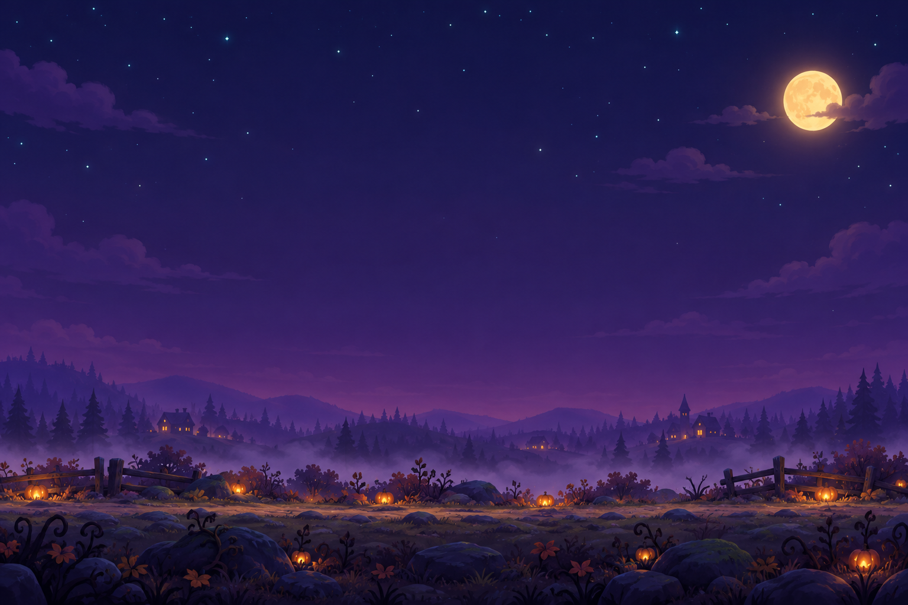
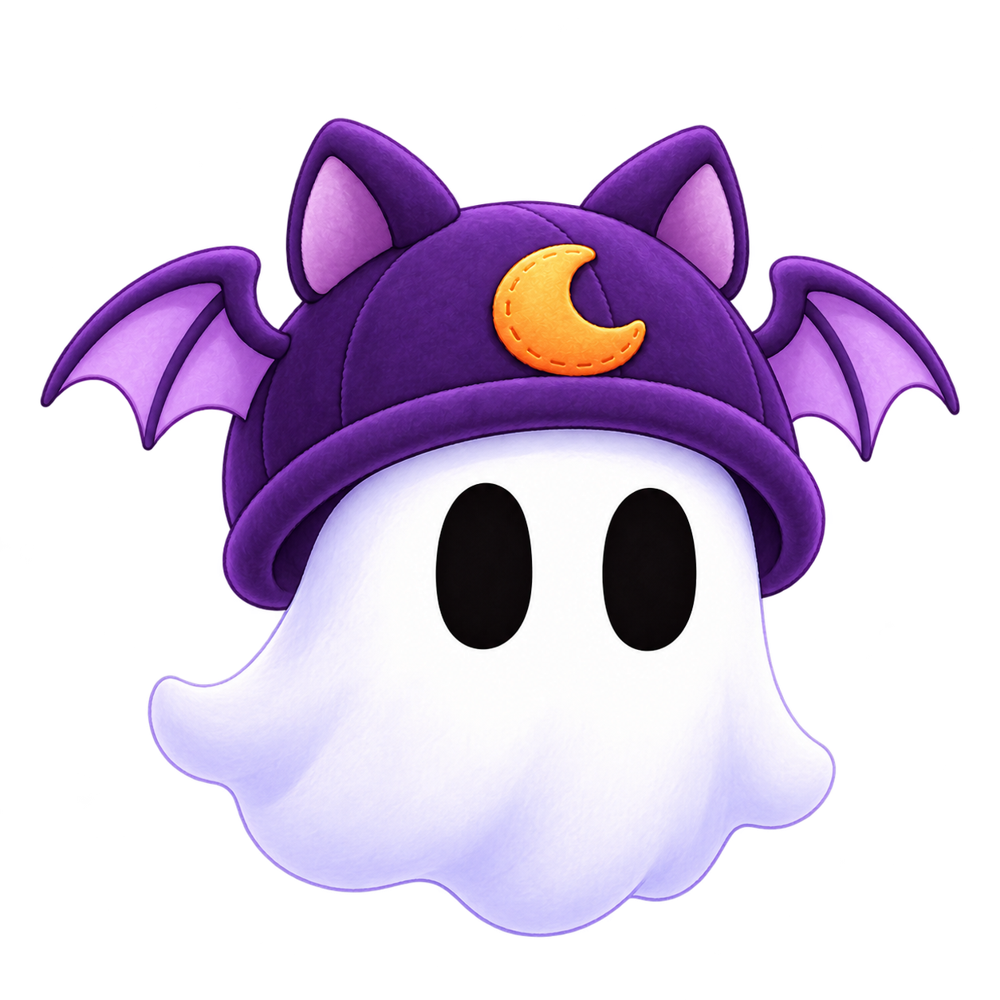
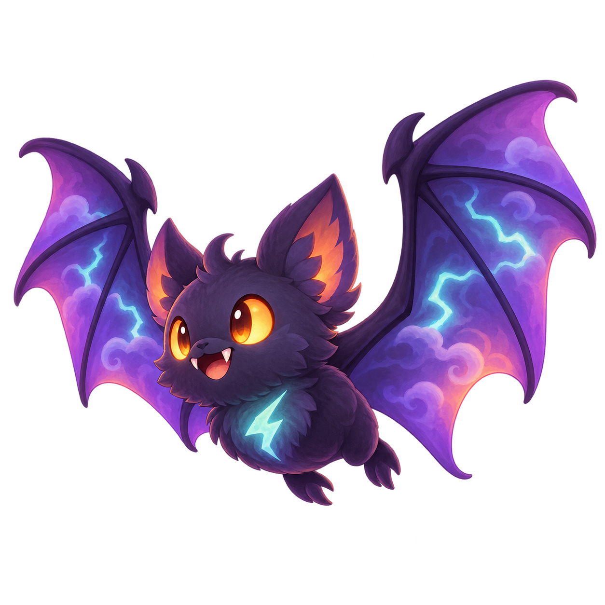
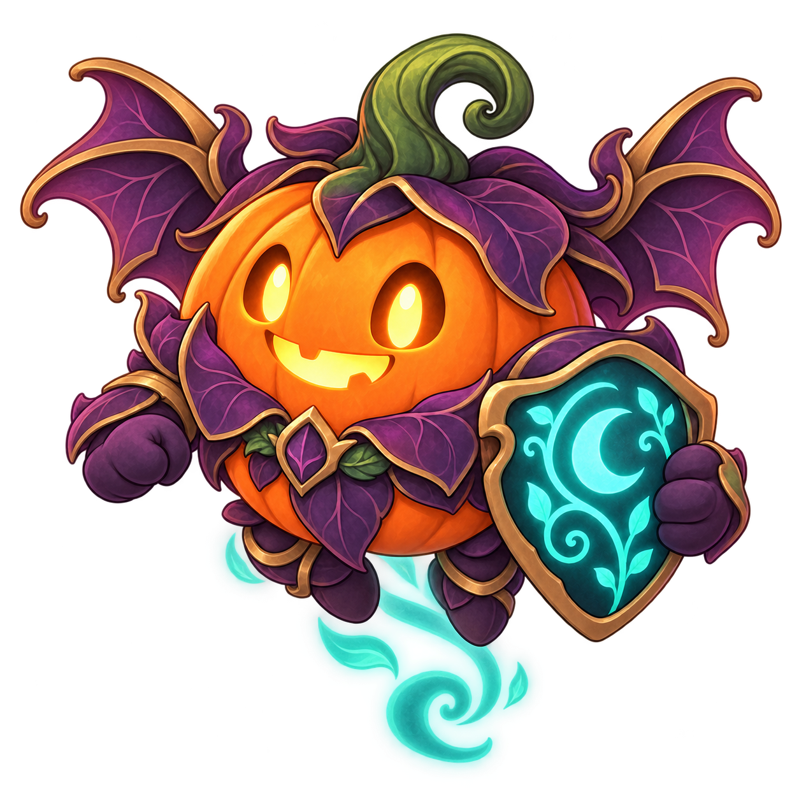
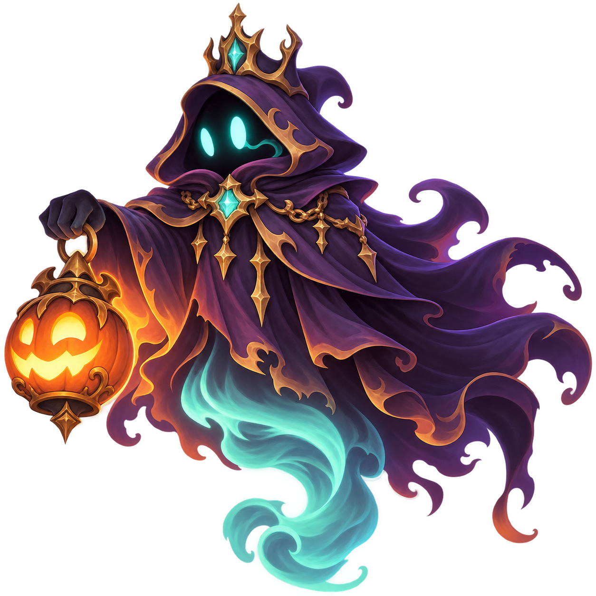

# Kiro's Haunted Flight

**Flap through a haunted sky. Battle its creatures. Borrow their powers. Dress your ghost.**

Kiro's Haunted Flight is a desktop browser adventure starring **Ghosty**, a friendly ghost navigating Halloween obstacles, choosing turn-based battles, and preparing for a final boss. Temporary spirit powers and shop upgrades shape each run, while earned Candy unlocks hats that stay with you.

Built with **Kiro**, plain JavaScript, and HTML5 Canvas. It runs locally with no backend, account, cloud deployment, or runtime AI API.

[Play locally](#play-locally) | [Meet-the-cast artwork](#meet-the-cast) | [Controls](#controls) | [Code guide](#code-guide)

## Play locally

From the repository root, install the test dependency and start a static web server:

```sh
npm install
python -m http.server 8177 --bind 127.0.0.1
```

Open **[http://127.0.0.1:8177/](http://127.0.0.1:8177/)**, then choose **Start Adventure**. Keep the terminal open while playing; **Ctrl+C** stops the server.

- **Requirements:** a modern desktop browser, Python 3 for the server above, and Node.js/npm for dependencies and tests.
- **Windows PowerShell:** use `npm.cmd install` and `npm.cmd test` if execution policy blocks `npm.ps1`.
- **macOS/Linux:** use `python3` if that is your Python command.
- Serve over HTTP rather than double-clicking `index.html`, because browsers can block ES modules loaded through `file://`.
- There is no build step. The npm script is `npm test`; the game is served directly from this directory.

## A moonlit adventure



*Scene artwork used by the game, shown here as an art preview rather than a gameplay screenshot.*

- **One-button flight:** flap through increasingly fast haunted wooden pillars, with readable gaps and responsive gravity.
- **Optional encounters:** fly into enemy symbols for short turn-based battles, or keep flying.
- **Enemy possession:** defeat Storm Bat or Pumpkin Guardian and choose whether to take its spirit.
- **Run-specific shops:** spend Soul Coins on healing potions, a shield, or an attack upgrade.
- **A final challenge:** survive to the mandatory boss at 120 seconds of active flight.
- **A permanent wardrobe:** earn Candy, preview hats, buy them, and equip a complete Ghosty appearance.
- **Desktop presentation:** a viewport-fitting playfield, fullscreen, illustrated characters, sound effects, music, and reduced-motion/mute settings.

Battle, shop, reward, and pause screens stop the flight clock. Encounter symbols are offered at 15 and 60 seconds; shops at 35 and 85 seconds. The offer appearing does not automatically enter the scene.

### Stay alive

Pipe contact is fatal unless a shield absorbs it. A shield holds one charge and protects against that particular pipe pair until Ghosty clears it; **ground and ceiling are always fatal**, even with a shield. Battle HP protects you in combat, not from flight collisions.

After a battle or shop, a safe checkpoint and countdown return you to flight. Ordinary pause preserves your exact position and velocity. Hats change appearance only: they never change the hitbox or difficulty.

## Meet the cast

Ghosty's wardrobe swaps between these five complete appearances. Select a card to preview it, choose **Buy** to unlock an affordable hat, then **Equip** to wear it. Selecting alone never spends Candy.

<table>
  <tr>
    <td align="center"><br><strong>No Hat</strong><br>Free</td>
    <td align="center"><br><strong>Witch Hat</strong><br>3 Candy</td>
    <td align="center"><br><strong>Pumpkin Cap</strong><br>6 Candy</td>
    <td align="center"><br><strong>Bat Bonnet</strong><br>10 Candy</td>
    <td align="center"><br><strong>Haunted Crown</strong><br>15 Candy</td>
  </tr>
</table>

<table>
  <tr>
    <td align="center"><br><strong>Storm Bat</strong></td>
    <td align="center"><br><strong>Pumpkin Guardian</strong></td>
    <td align="center"><br><strong>The Final Boss</strong></td>
  </tr>
</table>

*Character artwork. Explore all images and audition the audio in the [asset preview](assets/preview.html), served locally at [/assets/preview.html](http://127.0.0.1:8177/assets/preview.html).*

| Spirit | Flight benefit | Combat benefit |
|---|---|---|
| Storm Bat | Brief Hover, activated with E | Lightning strike |
| Pumpkin Guardian | One shield gift on first possession per run | Fortified Defend |

Only one spirit is active at a time. Switching replaces it without refilling HP, items, or cooldowns. Your saved hat remains independent of possession.

## Controls

Menus support mouse clicks and **Tab / Shift+Tab** navigation; **Enter / Space** activates a focused button.

| Context | Controls |
|---|---|
| Flight | **Space / playfield click** flaps; **E** or Flight Power uses an available spirit power |
| Pause | **P / Escape** pauses; Resume continues after a countdown; **Q** while paused ends the run |
| Battle | **1** Attack, **2** Defend, **3** Item, **4** Spirit move |
| Possession | **1** accepts/replaces the spirit; **2** declines |
| Wardrobe | Click a card or **1-5** to preview; use **Buy**, **Equip**, or **Back** |
| Shop | Click an item or **1-3** to select; **Buy** purchases; **U** uses an owned potion; **Leave Shop** returns |
| Display/settings | Use Fullscreen, Mute, and Reduced Motion controls |

Number shortcuts also support the numeric keypad. UI actions are separate from flight input, so selecting or buying an item should not flap or close another screen.

## Progress between runs

**Pipe Score** counts passed pairs, with your best saved as the high score. **Soul Coins** come from ordinary battle victories and buy upgrades for the current run. **Candy** is permanent:

```text
Candy = floor(activeFlightTime / 15) + (bossDefeated ? 3 : 0)
```

Candy is awarded once when a started run ends. A run shorter than 15 seconds earns no time-based Candy. Hats are permanent; spirits, HP, consumables, and upgrades reset for a new run.

Progress and settings save to browser `localStorage`. The main menu provides JSON save export/import for moving progress between browsers or devices; unfinished runs are not restored. Use the same browser profile, hostname, and port to access the same local save.

## Code guide

| Files | What they do |
|---|---|
| [index.html](index.html), [src/main.js](src/main.js) | Page layout, initialization, input routing, and connecting game systems |
| [state.js](src/state.js), [loop.js](src/loop.js), [input.js](src/input.js) | State transitions, fixed-step simulation, and keyboard/pointer intents |
| [config.js](src/config.js), [rng.js](src/rng.js) | Central tuning values and deterministic gameplay randomness |
| [systems/](src/systems) | Flight, pipes, collisions, scoring, scheduling, checkpoints, combat, economy, spirits, and Candy |
| [render.js](src/render.js), [assets.js](src/assets.js), [appearance.js](src/appearance.js), [audio.js](src/audio.js) | Drawing, cached images, sprite/hat selection, and sound/music |
| [ui/](src/ui), [save.js](src/save.js) | Interactive screens, HUD, feedback, and validated persistence |
| [test/](test), [test-support/](test-support) | Headless unit/property tests and shared helpers |

The logical world remains **960 x 640** while display scaling fits the screen. Simulation runs at **120 fixed steps per second**. Ghosty's **32 x 39** body and **24 x 31** collision hitbox stay independent of sprite and hat dimensions.

### Run tests

```sh
npm test
node --test test/flight.test.js
```

The suite uses Node's `node:test` runner and `fast-check`, with at least 100 generated cases per property test. Browser checks are still necessary for appearance, mouse/keyboard interaction, sound, fullscreen, and resizing.

## Project documents

- [Requirements](.kiro/specs/flappy-kiro/requirements.md), [design](.kiro/specs/flappy-kiro/design.md), and [milestone tasks](.kiro/specs/flappy-kiro/tasks.md) document the Kiro development workflow.
- [Steering files](.kiro/steering) define the product, stack, structure, gameplay invariants, and visual direction.
- [Asset notes](assets/README.md), [manifest](assets/manifest.json), and [generation prompts](assets/generation_prompts.json) explain artwork, registration, and provenance.

Adventure mode and desktop keyboard/mouse play are the current focus. See [LICENCE.md](LICENCE.md) for the repository's MIT No Attribution (MIT-0) license.
